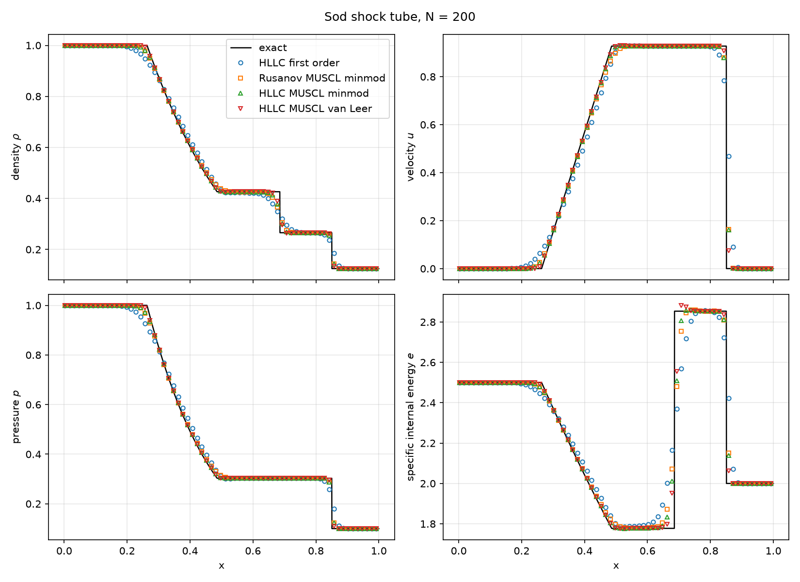
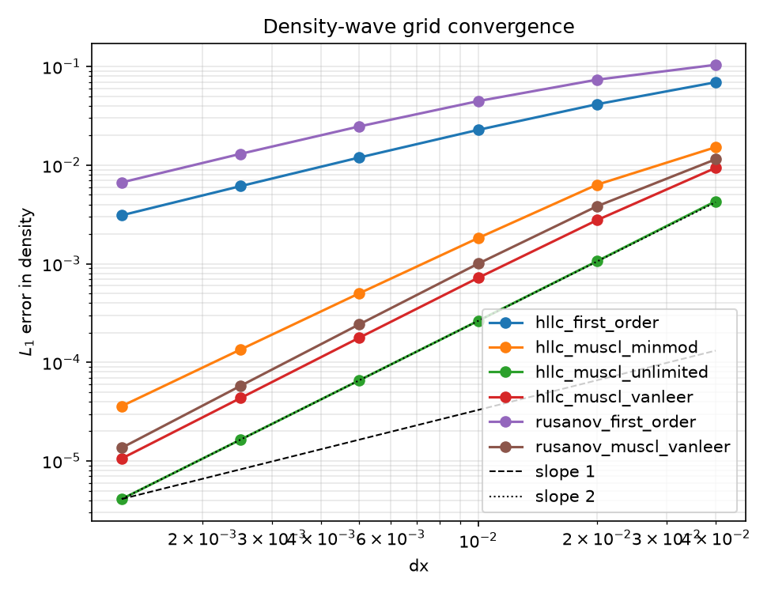
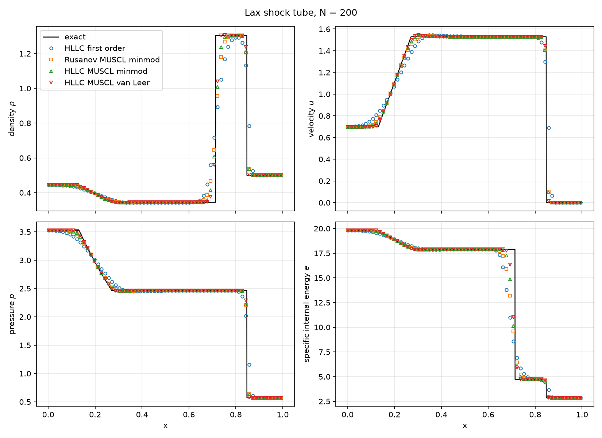

# euler1d-fvm

A from-scratch C++17 finite volume solver for the 1D compressible Euler equations with shock capturing and automated verification.

[](https://github.com/FreddyJuka/euler1d-fvm/actions/workflows/ci.yml)
[](LICENSE)




## Features

- HLLC and Rusanov (local Lax-Friedrichs) numerical fluxes
- First-order and MUSCL reconstruction in primitive variables, with minmod, van Leer [6] and unlimited (central) slopes
- SSP-RK3 time integration with a CFL-based time step
- Periodic and transmissive boundaries via ghost cells
- Config-file driven command-line interface with CSV output
- Automated grid-convergence study and shock-tube comparison against an exact Riemann solver
- Unit tests, sanitizer builds and an order-of-accuracy regression check in CI

## Governing equations

The 1D Euler equations in conservative form,

$$
\partial_t U + \partial_x F(U) = 0, \qquad
U = \begin{pmatrix} \rho \\ \rho u \\ E \end{pmatrix}, \qquad
F(U) = \begin{pmatrix} \rho u \\ \rho u^2 + p \\ u\,(E + p) \end{pmatrix},
$$

closed by the ideal-gas equation of state

$$
p = (\gamma - 1)\left(E - \tfrac12 \rho u^2\right), \qquad a = \sqrt{\gamma p / \rho},
$$

with $\gamma = 1.4$ by default. A state is admissible if $\rho > 0$ and $p > 0$; the solver stops with an error if any interior cell leaves this set.

## Numerical method

**Semi-discrete update.** On a uniform grid with cell width $\Delta x$, the cell averages evolve as

$$
\frac{dU_j}{dt} = -\frac{\hat F_{j+1/2} - \hat F_{j-1/2}}{\Delta x},
$$

where $\hat F_{j+1/2} = \hat F(W^L_{j+1/2}, W^R_{j+1/2})$ is a numerical flux evaluated from the reconstructed primitive states $W = (\rho, u, p)$ on both sides of the face.

**Rusanov flux** [8].

$$
\hat F = \tfrac12\left(F(W_L) + F(W_R)\right) - \tfrac12 s_{\max}\,\left(U_R - U_L\right), \qquad
s_{\max} = \max\left(|u_L| + a_L,\; |u_R| + a_R\right).
$$

**HLLC flux** [4] (Toro [1], Ch. 10). Wave speed estimates use Roe averages with $H = (E + p)/\rho$, $\sqrt{\rho}$ weights, and Einfeldt-type bounds [5]:

$$
\tilde u = \frac{\sqrt{\rho_L}\,u_L + \sqrt{\rho_R}\,u_R}{\sqrt{\rho_L} + \sqrt{\rho_R}}, \quad
\tilde H = \frac{\sqrt{\rho_L}\,H_L + \sqrt{\rho_R}\,H_R}{\sqrt{\rho_L} + \sqrt{\rho_R}}, \quad
\tilde a = \sqrt{(\gamma - 1)\left(\tilde H - \tfrac12 \tilde u^2\right)},
$$

$$
S_L = \min(u_L - a_L,\; \tilde u - \tilde a), \qquad S_R = \max(u_R + a_R,\; \tilde u + \tilde a).
$$

The contact speed and star states are

$$
S_* = \frac{p_R - p_L + \rho_L u_L (S_L - u_L) - \rho_R u_R (S_R - u_R)}{\rho_L (S_L - u_L) - \rho_R (S_R - u_R)},
$$

$$
U_{*K} = \rho_K \frac{S_K - u_K}{S_K - S_*}
\begin{pmatrix} 1 \\ S_* \\ \dfrac{E_K}{\rho_K} + (S_* - u_K)\left(S_* + \dfrac{p_K}{\rho_K (S_K - u_K)}\right) \end{pmatrix}, \quad K \in \{L, R\},
$$

and the flux is $F(W_L)$ if $S_L \ge 0$; $F(W_L) + S_L (U_{*L} - U_L)$ if $S_L < 0 \le S_*$; $F(W_R) + S_R (U_{*R} - U_R)$ if $S_* < 0 < S_R$; and $F(W_R)$ if $S_R \le 0$.

**MUSCL reconstruction.** Each primitive component $q$ in cell $j$ gets a limited slope $\sigma_j = \phi(\Delta_-, \Delta_+)$ from the one-sided differences $\Delta_- = q_j - q_{j-1}$ and $\Delta_+ = q_{j+1} - q_j$. The face values are $q^R_{j} = q_j + \tfrac12 \sigma_j$ (left state of face $j+1/2$) and $q^L_{j} = q_j - \tfrac12 \sigma_j$ (right state of face $j-1/2$). Three slope options are available:

| Slope | $\phi(a, b)$ |
|---|---|
| minmod | $0$ if $ab \le 0$, else $\operatorname{sign}(a)\min(\lvert a\rvert, \lvert b\rvert)$ |
| van Leer [6] | $0$ if $ab \le 0$, else $2ab/(a + b)$ |
| unlimited (central) | $\tfrac12 (a + b)$ |

The unlimited slope is not TVD and is intended only for smooth problems and for verifying the formal order of accuracy.

**Time integration.** The strong-stability-preserving third-order Runge-Kutta scheme of Shu and Osher [7], with $L(U)$ the spatial operator above:

$$
\begin{aligned}
U^{(1)} &= U^n + \Delta t\, L(U^n), \\
U^{(2)} &= \tfrac34 U^n + \tfrac14\left(U^{(1)} + \Delta t\, L(U^{(1)})\right), \\
U^{n+1} &= \tfrac13 U^n + \tfrac23\left(U^{(2)} + \Delta t\, L(U^{(2)})\right).
\end{aligned}
$$

The time step is computed once per step from $U^n$ as

$$
\Delta t = \mathrm{CFL}\;\frac{\Delta x}{\max_j\left(\lvert u_j\rvert + a_j\right)}, \qquad 0 < \mathrm{CFL} \le 1,
$$

and the last step is clipped so that the run ends exactly at $t_\text{final}$.

## Verification

### Density-wave convergence

An initial density wave $\rho(x, 0) = \rho_0 + A \sin(2\pi k\,(x - x_\text{min})/L)$ with $\rho_0 = 1$, $A = 0.2$, $u = 1$, $p = 1$ and $k = 1$ is advected on a periodic domain $[0, 1]$ for exactly one period ($t = 1$), with $\mathrm{CFL} = 0.8$ and the HLLC flux. The exact solution is the translated profile, so the density error is measured against it. To avoid a spurious $O(\Delta x^2)$ mismatch between point values and finite-volume averages, both the initial condition and the error use the exact **cell averages**,

$$
\bar\rho_j(t) = \rho_0 + A \sin\left(\kappa (x_j - u t - x_\text{min})\right)\,\frac{\sin(\kappa \Delta x / 2)}{\kappa \Delta x / 2}, \qquad \kappa = \frac{2\pi k}{L}.
$$

Observed orders $p$ are computed between consecutive grids as $p = \log(e_\text{coarse}/e_\text{fine}) / \log(N_\text{fine}/N_\text{coarse})$.

**HLLC + MUSCL, unlimited slope**

| N | dx | L1 | L2 | Linf | p_L1 | p_L2 | p_Linf |
|---:|---:|---:|---:|---:|---:|---:|---:|
| 25 | 4.000e-02 | 4.307e-03 | 4.781e-03 | 6.761e-03 | - | - | - |
| 50 | 2.000e-02 | 1.060e-03 | 1.177e-03 | 1.664e-03 | 2.02 | 2.02 | 2.02 |
| 100 | 1.000e-02 | 2.636e-04 | 2.928e-04 | 4.141e-04 | 2.01 | 2.01 | 2.01 |
| 200 | 5.000e-03 | 6.582e-05 | 7.312e-05 | 1.034e-04 | 2.00 | 2.00 | 2.00 |
| 400 | 2.500e-03 | 1.645e-05 | 1.827e-05 | 2.584e-05 | 2.00 | 2.00 | 2.00 |
| 800 | 1.250e-03 | 4.112e-06 | 4.568e-06 | 6.460e-06 | 2.00 | 2.00 | 2.00 |

**HLLC + MUSCL, van Leer limiter**

| N | dx | L1 | L2 | Linf | p_L1 | p_L2 | p_Linf |
|---:|---:|---:|---:|---:|---:|---:|---:|
| 25 | 4.000e-02 | 9.396e-03 | 1.081e-02 | 1.988e-02 | - | - | - |
| 50 | 2.000e-02 | 2.767e-03 | 3.360e-03 | 7.486e-03 | 1.76 | 1.69 | 1.41 |
| 100 | 1.000e-02 | 7.194e-04 | 1.001e-03 | 2.831e-03 | 1.94 | 1.75 | 1.40 |
| 200 | 5.000e-03 | 1.779e-04 | 2.947e-04 | 1.057e-03 | 2.02 | 1.76 | 1.42 |
| 400 | 2.500e-03 | 4.346e-05 | 8.671e-05 | 3.926e-04 | 2.03 | 1.76 | 1.43 |
| 800 | 1.250e-03 | 1.059e-05 | 2.562e-05 | 1.465e-04 | 2.04 | 1.76 | 1.42 |



Observations:

1. The unlimited MUSCL scheme reaches $p = 2.00$ in the L1, L2 and Linf norms, confirming formal second-order accuracy of the whole pipeline (reconstruction, HLLC flux, SSP-RK3, periodic ghost cells).
2. For a single sinusoidal error mode $A\sin(\cdot)$ the norms satisfy $L_2/L_1 = \pi/(2\sqrt2) \approx 1.1107$ and $L_\infty/L_1 = \pi/2 \approx 1.5708$. For the unlimited scheme on the finest grid ($N = 800$) the computed ratios are $L_2/L_1 = 1.1107$ and $L_\infty/L_1 = 1.5708$, and they stay within 0.1% of these values on all six grids. The error is therefore a single smooth mode, with no localized defects at the periodic boundary or in the ghost cells.
3. TVD limiters clip smooth extrema, so the error concentrates near the crest and trough of the wave. This gives the observed hierarchy $p_{L_1} > p_{L_2} > p_{L_\infty}$ (for van Leer at $N = 800$: 2.04, 1.76, 1.42), and the ratios above are no longer constant: for van Leer, $L_\infty/L_1$ grows from 2.1 at $N = 25$ to 13.8 at $N = 800$.

### Shock tubes

Both problems use $N = 200$ cells, transmissive boundaries, $\mathrm{CFL} = 0.8$, and are compared against the exact Riemann solution (`python/exact_riemann.py`, Toro Ch. 4). Sod's problem [2] is run to $t = 0.2$ and Lax's problem [3] to $t = 0.14$.




L1 error of the density against the exact solution at the cell centers ($N = 200$):

| Scheme | Sod | Lax |
|---|---:|---:|
| HLLC, first order | 1.331722e-02 | 3.705070e-02 |
| Rusanov, MUSCL minmod | 5.456449e-03 | 2.065369e-02 |
| HLLC, MUSCL minmod | 4.274980e-03 | 1.649593e-02 |
| HLLC, MUSCL van Leer | 2.995211e-03 | 1.225252e-02 |

HLLC resolves the contact discontinuity more sharply than Rusanov (compare the two MUSCL-minmod rows), and van Leer is the least dissipative of the limiters tested. In the Sod problem, the specific internal energy $e$ shows a small overshoot just to the right of the contact with the van Leer limiter (peak $e \approx 2.88$ against an exact plateau of $\approx 2.85$). This is expected: the TVD bound applies to the reconstructed primitive variables $(\rho, u, p)$, not to derived quantities such as $e = p/((\gamma-1)\rho)$.

## Build and run

Prerequisites: CMake >= 3.16, a C++17 compiler (GCC or Clang), and Python >= 3.10 for the post-processing scripts. GoogleTest is fetched automatically by CMake.

```bash
cmake -S . -B build -DCMAKE_BUILD_TYPE=Release
cmake --build build -j
ctest --test-dir build --output-on-failure
```

Run a case:

```bash
./build/euler1d cases/sod.cfg
```

```
Usage: euler1d <config.cfg> [--n-cells N] [--output-dir DIR] [--flux NAME]
               [--reconstruction NAME] [--limiter NAME] [--quiet] [--help]
  --n-cells N            override n_cells from the config file
  --output-dir DIR       override output_dir from the config file
  --flux NAME            override flux (rusanov, hllc)
  --reconstruction NAME  override reconstruction (first_order, muscl)
  --limiter NAME         override limiter (minmod, vanleer, van_leer, unlimited)
  --quiet                suppress the final summary line
  --help                 show this message
```

Each run writes `solution_initial.csv`, `solution_final.csv`, `residuals.csv` and `summary.csv` into `output_dir`.

Config files use `key = value` lines with `#` comments. `cases/sod.cfg`:

```ini
# Sod shock tube. Reference: G. A. Sod, J. Comput. Phys. 27 (1978) 1-31;
# Toro, Riemann Solvers and Numerical Methods for Fluid Dynamics, Test 1.
problem = riemann
n_cells = 200
x_min = 0.0
x_max = 1.0
x0 = 0.5
rho_L = 1.0
u_L = 0.0
p_L = 1.0
rho_R = 0.125
u_R = 0.0
p_R = 0.1
t_final = 0.2
cfl = 0.8
flux = hllc
reconstruction = muscl
limiter = minmod
bc_left = transmissive
bc_right = transmissive
output_dir = results/sod
```

Optional keys: `gamma` (default 1.4), `max_steps` (default 1000000), and `limiter` (required when `reconstruction = muscl`). Density-wave cases use `rho0`, `amplitude`, `u0`, `p0` and `wavenumber` instead of the Riemann keys; see `cases/density_wave.cfg`.

CMake options: `EULER1D_BUILD_TESTS` (default ON), `EULER1D_WARNINGS_AS_ERRORS` (default OFF), `EULER1D_SANITIZE` (AddressSanitizer + UBSan, default OFF).

## Reproducing the results

```bash
python3 -m venv .venv
source .venv/bin/activate
pip install -r requirements.txt

scripts/run_convergence.sh     # grid-convergence study -> results/convergence/
scripts/run_shock_tubes.sh     # Sod and Lax comparisons -> results/shock_tubes/
scripts/make_figures.sh        # both of the above, then copies the figures to docs/figures/
python -m pytest tests/python  # exact Riemann solver tests
```

## Project structure

```
include/euler1d/   public headers
src/               library sources and the CLI (main.cpp)
  eos.cpp            ideal-gas equation of state
  flux.cpp           physical flux, Rusanov and HLLC
  reconstruction.cpp first-order / MUSCL reconstruction and slope limiters
  mesh.cpp           uniform grid with ghost cells
  boundary.cpp       periodic and transmissive boundaries
  time_integration.cpp CFL time step
  solver.cpp         SSP-RK3 solver driver
  problems.cpp       initial conditions and density-wave error norms
  io.cpp             config parsing and CSV output
cases/             Sod, Lax and density-wave configuration files
tests/             GoogleTest unit tests; tests/python holds pytest tests
python/            exact Riemann solver, plotting and convergence analysis
scripts/           convergence, shock-tube and figure-generation scripts
docs/figures/      figures used in this README
.github/workflows/ CI configuration
```

## Testing and CI

The unit tests cover the equation of state, fluxes, mesh and boundaries, reconstruction, time step and solver, configuration parsing, initial conditions and the command-line interface. The GitHub Actions workflow has three jobs:

- **build-test**: builds with GCC and Clang in Release mode with warnings as errors and runs `ctest`.
- **sanitizers**: builds in Debug mode with AddressSanitizer and UBSan and runs `ctest`.
- **verification**: runs the Python tests and the grid-convergence study on $N = 50, 100, 200, 400$, then fails if the observed order on the finest grid leaves the expected range (unlimited MUSCL, L1 and Linf: 1.9-2.1; first-order HLLC, L1: 0.85-1.1). The convergence report is uploaded as a workflow artifact.

## Roadmap

- Roe flux with an entropy fix
- WENO5 reconstruction
- Characteristic-variable reconstruction
- Reflective boundaries
- Shu-Osher test
- OpenMP parallelization

## References

1. E. F. Toro, *Riemann Solvers and Numerical Methods for Fluid Dynamics*, 3rd ed., Springer, 2009.
2. G. A. Sod, J. Comput. Phys. 27 (1978) 1-31.
3. P. D. Lax, Comm. Pure Appl. Math. 7 (1954) 159-193.
4. E. F. Toro, M. Spruce, W. Speares, Shock Waves 4 (1994) 25-34.
5. B. Einfeldt, SIAM J. Numer. Anal. 25 (1988) 294-318.
6. B. van Leer, J. Comput. Phys. 32 (1979) 101-136.
7. C.-W. Shu, S. Osher, J. Comput. Phys. 77 (1988) 439-471.
8. V. V. Rusanov, USSR Comput. Math. Math. Phys. 1 (1962) 304-320.

## License

MIT, see [LICENSE](LICENSE).

## Author

Freddy Juka
